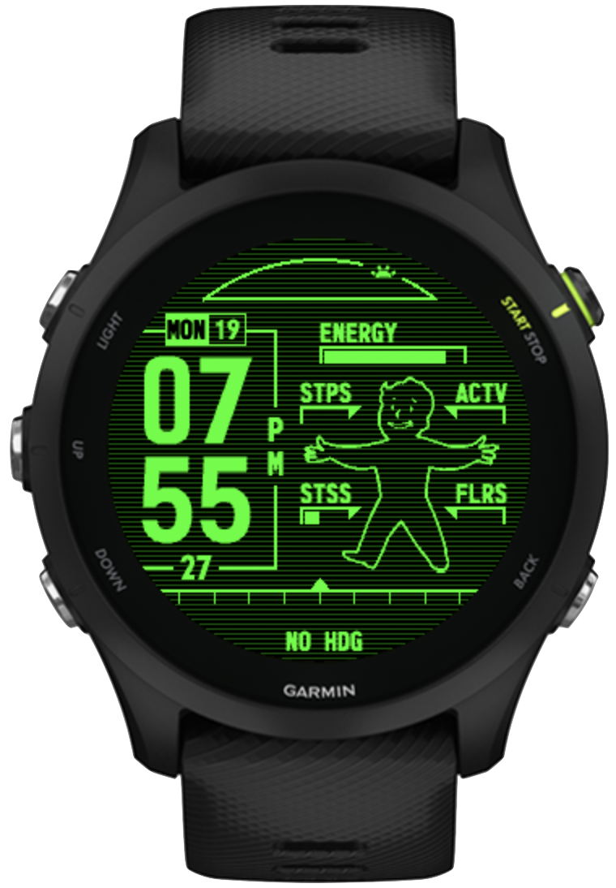

# A Pip-Boy face for Garmin watches

A Fallout Pip-Boy style watch face for Garmin devices, written in Monkey C for Connect IQ.

<p align="center">
  
</p>

## Supported devices

The manifest targets the **Forerunner 255 Music** (`fr255m`, 260×260) and **Forerunner 255S Music** (`fr255sm`, 218×218). Many positions are hard-coded in pixels and were tuned on the 255 Music, so the 255S Music may need some layout tweaks. Other devices can be added to `manifest.xml` and may need tweaks too.

## Building

1. Install the [Connect IQ SDK](https://developer.garmin.com/connect-iq/sdk/) with the SDK Manager, and download the device files for your watch.
2. Generate a developer key, if you don't have one:

   ```sh
   openssl genrsa -out developer_key.pem 4096
   openssl pkcs8 -topk8 -inform PEM -outform DER -in developer_key.pem -out developer_key -nocrypt
   ```

3. Build the watch face:

   ```sh
   # Replace fr255m with your device ID:
   monkeyc -f monkey.jungle -d fr255m -o bin/PipBoy.prg -y /path/to/developer_key
   ```

   You can also try the face in the simulator first. To do so, open it with `connectiq` and then run `monkeydo bin/PipBoy.prg fr255m`.

You can also open the folder in VS Code with the [Monkey C extension](https://marketplace.visualstudio.com/items?itemName=garmin.monkey-c) and use **Monkey C: Build for Device**.

## Installing on your watch

1. Connect the watch over USB. On macOS you'll need an MTP client such as [OpenMTP](https://openmtp.ganeshrvel.com/), because Garmins (or at least Forerunners) don't mount as a drive.
2. Copy `PipBoy.prg` into the `GARMIN/APPS/` folder on the watch.
3. Disconnect, then choose the face under **Watch Face** on the watch.

Sideloaded apps don't show settings in the Garmin Connect app, so the face uses its default green theme. To try the other themes, change the setting in the simulator under **File → Edit Persistent Storage**.

## License

The source code is released under the [MIT License](LICENSE).

That license does not cover Fallout, Pip-Boy, and Vault Boy, which are trademarks of Bethesda Softworks LLC. The Fallout-related artwork in this repo is unofficial fan art. This project is not affiliated with or endorsed by Bethesda or its parent company.

Additionally, Monofonto (`resources/fonts/monofonto/`) is a typeface by [Typodermic Fonts](https://typodermicfonts.com/), included under Typodermic's license in bitmap format.